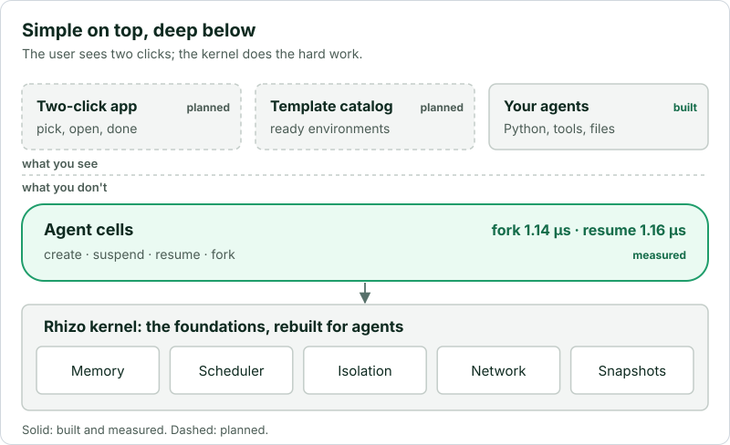
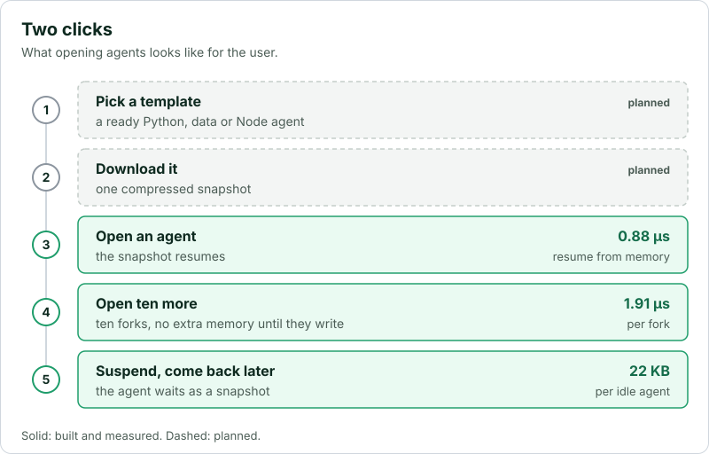
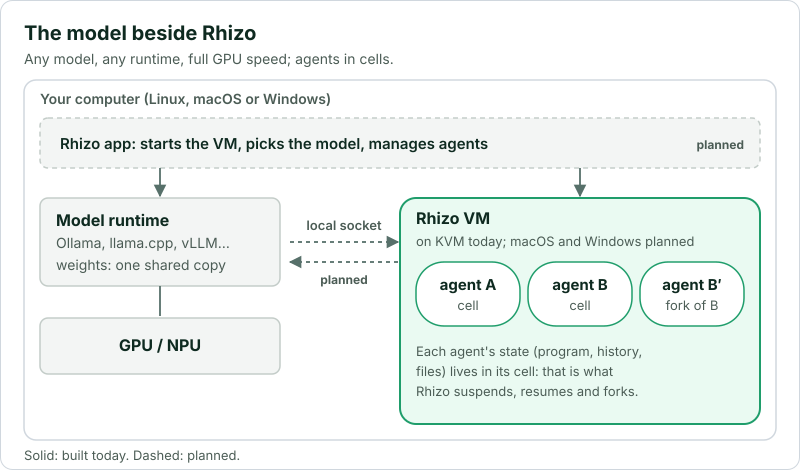
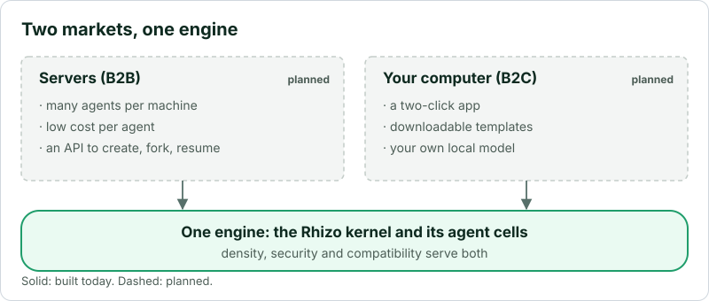
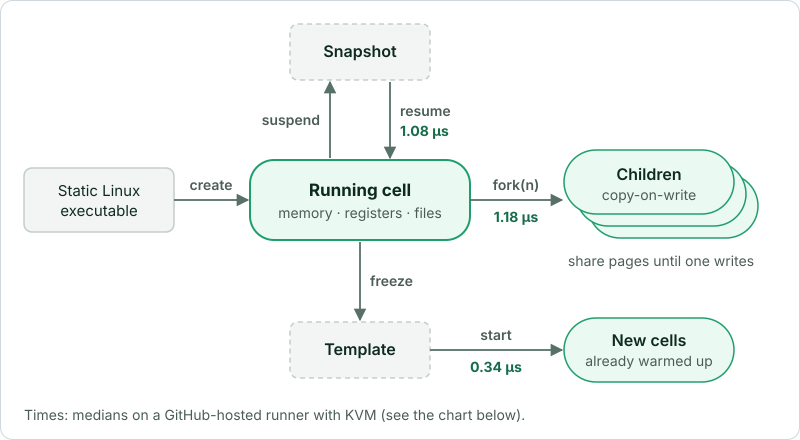
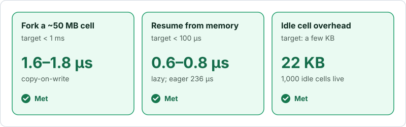
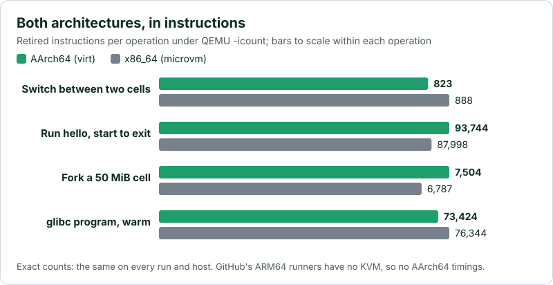

<p align="center">
  <picture>
    <source media="(prefers-color-scheme: dark)" srcset="docs/logo/rhizo-logo-dark.svg">
    
  </picture>
</p>

<p align="center"><b>An operating system kernel built for AI agents.</b></p>

AI agents write and run code. Each one needs a safe place to do it: a sandbox
it cannot escape, that starts instantly, costs nothing while the agent waits
for the model, and can be paused, resumed or copied to try several ideas at
once. Today that place is built from pieces made for something else (virtual
machines, containers, processes), and it shows: slow to start, heavy to keep,
expensive to copy.

Rhizo is an operating system kernel built for that job. Its basic unit is the
**agent cell**, a sealed environment that the kernel itself can create,
suspend, resume and fork in microseconds. It is meant for two kinds of users:

- **platforms that run many agents on servers**, where density, cost per agent
  and isolation between customers matter;
- **people running agents on their own computer**, next to a local model,
  where an agent should cost almost nothing while idle.

Underneath, Rhizo is deep: it rebuilds memory, scheduling and isolation around
the agent. On top, the goal is that none of it shows: two clicks and your
agents are ready, fast and safe. Rhizo is open source (MIT) and written in
Rust.

> **Status: pre-alpha proof of concept.** Nothing here is usable in production
> yet. See [where it stands](#status).

## The problem

An AI agent that runs code today sits on top of a tall stack. Every layer was
designed for something else, and what agents need most (fast suspend and
resume, cheap clones of the whole environment, strict isolation of untrusted
code) is bolted on from the outside.

<p align="center">
  <picture>
    <source media="(prefers-color-scheme: dark)" srcset="docs/img/stack-dark.svg">
    
  </picture>
</p>

Agent workloads look nothing like classic services:

| Classic service | AI agent |
|---|---|
| Long-lived, always on | Short bursts, mostly idle (waiting for a model or a human) |
| Trusted code | Untrusted, model-generated code |
| Tens per node | Thousands per node, most of them asleep |
| Scaling means more replicas | What matters is suspending and resuming quickly |
| Static permissions | Per-task permissions: tools, network, secrets |

Rhizo explores what happens when those needs are the design center of the
kernel itself. The name comes from the *rhizome*: an underground stem that
branches into independent shoots (fork), can regrow a whole plant from a
fragment (snapshot) and lies dormant until it sprouts again (suspend/resume).

## Vision

Rhizo is complex underneath so that it can be simple on top. The kernel
rebuilds the foundations of the operating system around the agent; the person
using it sees none of that.

<p align="center">
  <picture>
    <source media="(prefers-color-scheme: dark)" srcset="docs/img/layers-dark.svg">
    
  </picture>
</p>

For someone running agents, it should look like this. The steps that exist
today show their measured time; the others are planned:

<p align="center">
  <picture>
    <source media="(prefers-color-scheme: dark)" srcset="docs/img/clicks-dark.svg">
    
  </picture>
</p>

On a personal computer the model runs next to Rhizo, not inside it: any model
and any runtime, at full GPU speed. Agents live in cells and talk to the model
over a local socket.

<p align="center">
  <picture>
    <source media="(prefers-color-scheme: dark)" srcset="docs/img/model-dark.svg">
    
  </picture>
</p>

The same engine serves servers and personal computers:

<p align="center">
  <picture>
    <source media="(prefers-color-scheme: dark)" srcset="docs/img/markets-dark.svg">
    
  </picture>
</p>

The full picture, and what the kernel still needs for it, is in
[`docs/vision.md`](docs/vision.md).

## Status

<p align="center">
  <picture>
    <source media="(prefers-color-scheme: dark)" srcset="docs/img/roadmap-dark.svg">
    
  </picture>
</p>

Each stage groups several pieces of work, and each piece ships its speed work
with a benchmark that proves it; the details live in the archived changes
under [`openspec/changes/archive/`](openspec/changes/archive/).

Out of scope for the proof of concept: real disks, hardware other than
virtio/QEMU, SDKs.

## What a cell can do

A cell runs an unmodified Linux program (Rust or C with glibc, static or
dynamically linked, or an interpreter such as CPython or Node.js) through a
Linux-compatible system call layer. Its whole state (memory, registers,
files) belongs to the kernel, so the kernel can stop it, copy it and start it
again:

<p align="center">
  <picture>
    <source media="(prefers-color-scheme: dark)" srcset="docs/img/lifecycle-dark.svg">
    
  </picture>
</p>

- **Suspend / resume.** A snapshot is a versioned image of the cell. Resume
  is lazy: pages come back on first touch. A snapshot refers to the pages
  the cell still shares with its template or its forks instead of copying
  them, so 50 agents of one template, 45 of them suspended, take 6.6 MB
  on x86_64 (60 MB when snapshots copied every page); a snapshot exported as bytes
  stands alone.
- **Fork(n).** Children share the parent's pages, and even its page tables,
  until one of them writes.
- **Templates.** Freeze a cell after its warm-up, then start new cells from it
  instead of from the executable.
- **Threads.** `pthread_create`, mutexes, condition variables and futexes;
  snapshots, forks and templates carry every thread.
- **Network.** Pipes, `poll`/`select`/`epoll`, Unix and TCP/UDP sockets
  between cells, and a virtio-net card (smoltcp) to reach the outside;
  the kernel keeps a suspended cell's connections open and hands them back
  on resume, and a fork's copies of them are reset.
- **Multi-core.** Cells run in parallel on up to 16 CPUs; CPUs that no
  other cell needs run more threads of a running cell at once (TLB
  shootdowns on x86_64); only system calls on sockets take turns.
- **CPython and packages from PyPI.** Unmodified CPython 3.13 runs as a
  cell, its standard library in the cell's own files; a template frozen
  after its imports answers each request without starting the interpreter
  again. A dynamically linked build loads packages installed from their
  PyPI wheels, C extensions included: numpy (with OpenBLAS) and requests.
  numpy's computation takes about as long as in a Linux process in the
  same kind of VM, cold or forked from a warm interpreter.
- **Node.js.** The official Node.js 24 build, dynamically linked and
  unmodified, runs as a cell with its JIT: V8 asks for memory both
  writable and executable, and the kernel gives it pages that are either,
  changed on faults, never both (change `node-jit`). A cell forked from
  Node.js frozen after its warm-up answers in about 4 ms, against about
  35 ms from a cold start (with `--jitless`), in a cell or as a Linux
  process (which cannot fork Node.js).
- **Control plane.** `rhizo`, a command-line tool on the host, drives a
  running kernel over its serial line: `rhizo up`, `run`, `ps`, `fork`,
  `suspend`, `resume`, `attach`, `kill`, `down`; `rhizo chat` is an
  interactive conversation with an agent in a cell, whose tools run in
  the cell, and which can be suspended and picked up later.
- **Quotas.** The host can cap each cell's memory, CPU time, descriptors
  and sockets; a cell past its quota is refused or ended, not its
  neighbours, and its quotas travel with its snapshots and forks.
- **Isolation, reviewed.** Two adversarial reviews of the cell boundary and
  one of frames from the network, with hostile cells, property tests and a
  network fuzzer that keep the findings fixed. The kernel is unmapped
  while cell code runs on x86_64 CPUs open to Meltdown (KPTI; E0PD on
  AArch64), and kept out of cell memory (SMEP, SMAP, PAN).
  [`docs/security.md`](docs/security.md) lists the threat model, the
  findings and what is still open;
  [`docs/audit-scope.md`](docs/audit-scope.md) scopes an external audit.

## Thesis

The proof of concept must demonstrate one measurable claim:

> A kernel whose unit is the agent cell can create, suspend, resume and fork
> cells running real Linux programs orders of magnitude faster than today's
> microVM- and userspace-kernel-based sandboxes.

A cell is born inside a kernel that is already running, so it is closer to a
process than to a VM. The measurements below therefore come in two tiers: a
cell against a Linux process doing the same operation in the same kind of VM
(the like-for-like gain, and the smaller one), and whole microVMs and
sandboxes, shown for scale. Resume is shown lazy (pages come back on first
touch) and eager (every page restored first).

The targets are hypotheses the proof of concept must validate. Where they stand:

<p align="center">
  <picture>
    <source media="(prefers-color-scheme: dark)" srcset="docs/img/scorecard-dark.svg">
    
  </picture>
</p>

<details>
<summary>Targets next to the figures other sandboxes publish</summary>

The comparison figures are what each project or its users have published, on
different hardware and with different measurement methods, so they are orders
of magnitude to aim at, not a like-for-like comparison. The like-for-like
numbers are [below](#measured).

| Metric | Rhizo target | Firecracker | Unikraft | Hyperlight |
|---|---|---|---|---|
| Boot: VMM launch → guest ready (KVM) | **≤ 10 ms** (kernel part ≤ 1 ms) | < 125 ms to a Linux guest accepting API calls[^fc] | < 1 ms guest boot, ~3 ms including the Firecracker VMM[^uk] | sub-millisecond partition creation, no guest OS (reported)[^hl] |
| Resume a suspended cell / VM | **< 100 µs** (in-kernel, no VMM) | 4–28 ms snapshot restore reported[^fcr] | — | ~0.9 ms snapshot restore (hyperlight-unikraft v0.16)[^hlu] |
| Fork a 50 MiB cell | **< 1 ms** (stretch: < 200 µs with lazy copy-on-write) | no native fork (snapshot + restore of a copy) | no native fork in the open-source core | no native fork |
| Idle cell overhead | **a few KiB** plus its own pages | a microVM per sandbox (MiBs) | a microVM per app | a micro-VM per sandbox |

</details>

[^fc]: Agache et al., *Firecracker: Lightweight Virtualization for Serverless Applications*, NSDI 2020.
[^uk]: [Unikraft performance documentation](https://unikraft.org/docs/concepts/performance).
[^hl]: [Firecracker vs Microsoft Hyperlight](https://www.pandastack.ai/blog/firecracker-vs-microsoft-hyperlight/) (qualitative, not an official measurement).
[^fcr]: [Benchmarking Firecracker boot and restore](https://numavm.com/blog/2026-03-10-1-second-boot/) and [Restoring uniqueness in microVM snapshots](https://arxiv.org/pdf/2102.12892).
[^hlu]: [hyperlight-unikraft v0.16.0 release notes](https://github.com/hyperlight-dev/hyperlight-unikraft/releases/tag/v0.16.0).

## Measured

`cargo xtask bench` measures Rhizo and the existing mechanisms in the same run,
on the same machine, with the same clock:

<p align="center">
  <picture>
    <source media="(prefers-color-scheme: dark)" srcset="docs/img/measured-dark.svg">
    
  </picture>
</p>

The same operations on both architectures, counted in instructions (exact,
so comparable across runs):

<p align="center">
  <picture>
    <source media="(prefers-color-scheme: dark)" srcset="docs/img/arches-dark.svg">
    
  </picture>
</p>

The charts and the tables below come from the same run (the date is under the
tables). Shared runners are noisy, so figures move between runs; publishable
numbers will come from a dedicated machine. How benchmarks, environments and baselines work:
[`bench/README.md`](bench/README.md).

Two reference workloads run the kernel the way its two kinds of users
will ([`bench/README.md`](bench/README.md#reference-workloads)), on every
VMM of the same run:

- **Laptop**: 50 agents opened from one template in a 512 MiB VM, 45 of
  them suspended, take 6.6 MB together; opening one takes a few
  microseconds (about 60 to 80 µs on Firecracker), and while every agent
  waits the VM's CPUs wake about once a second.
- **Server**: 10,000 busy cells in a 1 GiB VM with one vCPU, about 35,000
  to 46,000 operations per second; the 99th percentile of the time a cell
  waits for the CPU (a few milliseconds) is gated like the other figures. Pushed
  until memory runs out (about 46,000 idle cells), the kernel refuses new
  cells cleanly and gets every byte back, its heap included.

<details>
<summary>Boot time and the full comparison table</summary>

<!-- bench:start -->
Time from launching the VMM to the guest being ready (median, lower is better).
Rhizo prints its ready line at the end of boot; the reference is Firecracker's
CI Linux guest kernel with a minimal `/init` that prints the same line, booted
on the same machine with the same timing method.

<picture><source media="(prefers-color-scheme: dark)" srcset="bench/boot-time-dark.svg"></picture>

| VMM | Rhizo median (ms) | Rhizo p90 (ms) | Linux median (ms) | Linux p90 (ms) | Runs |
|---|---:|---:|---:|---:|---:|
| Firecracker | 5.6 | 6.4 | 171.1 | 174.5 | 20 |
| Cloud Hypervisor | 8.6 | 11.3 | 91.6 | 104.2 | 20 |
| QEMU microvm | 41.9 | 42.4 | — | — | 20 |
| QEMU q35 | 53.4 | 56.4 | 160.3 | 170.5 | 20 |

### A cell against a Linux process, in the same kind of VM

Same machine, same run. Rhizo runs inside Firecracker, and so does the Linux guest of the middle column (the same static programs, as its `/init`): both sides pay the same virtualization. The last column is the same program on the host, one layer of virtualization less. Lazy resume brings pages back on first touch; eager restores every page before the program runs.

| Operation | Rhizo cell | Linux process, same VM | Linux process, host |
|---|---:|---:|---:|
| The `fork` call, holding 50 MiB written | 1.9 µs | 254.7 µs | 821.2 µs |
| Fork, then the child writes all 50 MiB and exits | 3.31 ms | 30.64 ms | 28.85 ms |
| Start a program and run it to its exit (`hello`) | 10.4 µs | 513.2 µs | 132.2 µs |
| Resume a suspended 8 MiB program: lazy / eager (CRIU on the host) | 0.9 µs / 237.5 µs | — | 4.65 ms (CRIU) |

### Whole VMs and sandboxes, for scale

A microVM or a sandbox starts or restores a whole environment (a VM, or a sandbox process with its own kernel), a larger scope than a cell: these figures show the scale, not a like-for-like speed-up. The microVM is a Linux guest in Firecracker (boot to its first output, or a snapshot restored by a new Firecracker process); the gVisor sandbox runs on the host.

| Operation | Rhizo cell | Firecracker microVM | gVisor sandbox |
|---|---:|---:|---:|
| Start a program and run it to its exit (`hello`) | 10.4 µs | 171.09 ms | 75.46 ms |
| Resume a suspended environment until it runs (eager for the cell) | 237.5 µs | 3.71 ms | 104.81 ms |

### A real interpreter

CPython (static, 3.13.18) answering one agent tool call (`cells/python/agent_demo.py`: JSON, regular expressions, dates; the standard library it imports compiled in the cell's own files), in a cell and as a Linux process in the same Firecracker VM:

| Started | Rhizo cell | Linux process |
|---|---:|---:|
| Cold, from its executable (interpreter start, imports, warm-up) | 17.85 ms | 21.37 ms |
| Forked from an interpreter frozen (cell) or kept (process) after the warm-up | 3.65 ms (4.9× faster) | 6.03 ms |

MicroPython (static, v1.24.1) answering one request (`cells/python/rhizo_demo.py`, imported from the cell's own files), in a cell in Firecracker:

| Started | Time |
|---|---:|
| Cold, from its executable (interpreter start, imports, warm-up) | 3.59 ms |
| Forked from a template frozen after the warm-up | 442.7 µs (8.1× faster) |

numpy and its OpenBLAS, installed from their PyPI wheels into a dynamically linked CPython, computing on arrays (`cells/python/numpy_demo.py`: a linear solve, a ufunc, a matrix product), in a cell and as a Linux process in the same Firecracker VM:

| Started | Rhizo cell | Linux process |
|---|---:|---:|
| Cold (interpreter start, `import numpy`, compute) | 67.55 ms | 70.51 ms |
| Forked from an interpreter frozen (cell) or kept (process) after `import numpy` | 13.89 ms (4.9× faster) | 16.07 ms |

Node.js (the official build, dynamically linked, run unmodified with `--jitless`) answering one agent tool call (`cells/node/demo.js`), in a cell and as a Linux process in the same Firecracker VM (Node.js cannot fork itself, so the process has no warm row):

| Started | Rhizo cell | Linux process |
|---|---:|---:|
| Cold, from its executable (`ld.so`, V8 start-up, warm-up) | 34.32 ms | 40.57 ms |
| Forked from Node.js frozen after its warm-up | 4.11 ms (8.4× faster) | — |

### Both architectures, in instructions

Retired instructions per operation, counted under QEMU with `-icount` (the same on every run and every host): x86_64 on `microvm`, AArch64 on `virt`. GitHub's ARM64 runners have no KVM, so AArch64 has no timings from CI.

| Operation | x86_64 | AArch64 |
|---|---:|---:|
| Switch between two cells | 885 | 831 |
| Create the `hello` cell | 28,338 | 51,488 |
| Run `hello` from start to exit | 89,161 | 124,480 |
| Fork a cell holding 50 MiB | 6,697 | 7,504 |
| A static glibc program, cold | 35,444,511 | 39,887,984 |
| The same, forked from a warm template | 77,261 | 92,736 |

Environment: `ci`, KVM: yes, measured 2026-11-21. Regenerate with
`cargo xtask bench --readme`.
<!-- bench:end -->

</details>

## Try it

You need [rustup](https://rustup.rs) (the pinned toolchain installs itself)
and QEMU 8.2 or later; the C test cells also need gcc with a static glibc.
On Debian/Ubuntu:

```bash
sudo apt-get install qemu-system-arm qemu-system-x86 gcc libc6-dev
```

Boot the kernel, run the in-kernel tests and every cell (AArch64, the default):

```bash
cargo xtask test
```

The same on the second architecture:

```bash
cargo xtask --arch x86_64 test
```

Benchmarks (Firecracker and Cloud Hypervisor need KVM; `xtask` downloads
pinned releases on first use):

```bash
cargo xtask bench
```

```bash
cargo xtask --arch x86_64 bench
```

A CPython agent in a cell talking to your own local model (Ollama or
llama.cpp), forked and suspended live through `rhizo`, the control plane's
command-line tool (`rhizo up`, `rhizo run python-agent`, `rhizo ps`,
`rhizo fork`, `rhizo down`), or a conversation with an agent whose tools
run in its cell (`rhizo chat`): [docs/demo.md](docs/demo.md).

`cargo xtask check` is the fast loop (format, lints, host tests, crate rules)
and `cargo xtask ci` runs everything CI runs. AArch64 is the primary
architecture: 16-bit ASIDs and TLB invalidation broadcast in hardware suit
cells that switch and fork all the time. x86_64 stays because GitHub's x86_64
runners are where CI can measure with KVM; only the thin `arch/` layer exists
twice, and every spec is tested on both
([trade-offs](openspec/changes/archive/2026-11-19-switch-to-arm64/design.md)).

## Principles

- **Primitives in the kernel.** Snapshot, resume, fork and capabilities are
  native kernel operations, not features added on top.
- **Linux ABI, not Linux code.** Cells run unmodified Linux binaries through a
  Linux-compatible syscall layer. No GPL code is copied into this repository.
- **Deterministic by design.** All hardware access goes through narrow
  interfaces so the kernel core can run inside a deterministic simulator.
- **Performance is a test.** Benchmarks run in CI with thresholds; a regression
  fails the build.
- **Specs first.** Every behavior is specified before it is built
  (see [`openspec/`](openspec/)).
- **Open for real.** MIT licensed, no proprietary core, no "open core" bait.
- **Model-agnostic.** Contribute with any AI coding agent, or with none.

## Learn more

- [`openspec/specs/`](openspec/specs/): how the system behaves today, one spec
  per capability.
- [`docs/vision.md`](docs/vision.md): where Rhizo goes after the proof of
  concept (servers and local AI, one engine) and what the kernel needs for it.
- [`bench/README.md`](bench/README.md): every metric, environment and baseline.
- [`AGENTS.md`](AGENTS.md): code map, rules and the feedback loop (for people
  and AI coding agents alike).
- [`CONTRIBUTING.md`](CONTRIBUTING.md): how to contribute, with or without AI
  tools.

## License

[MIT](LICENSE)
