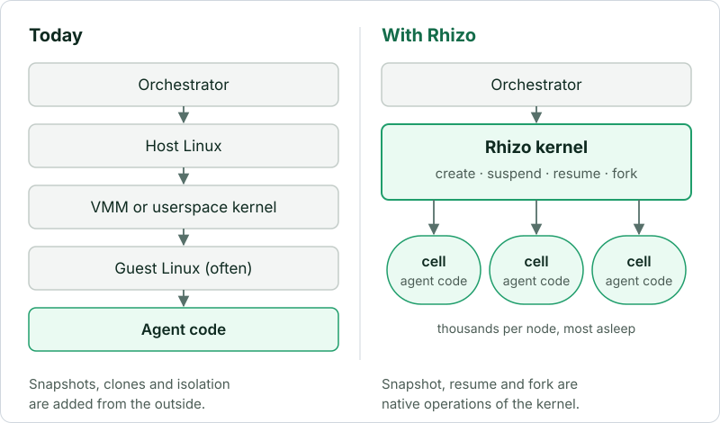
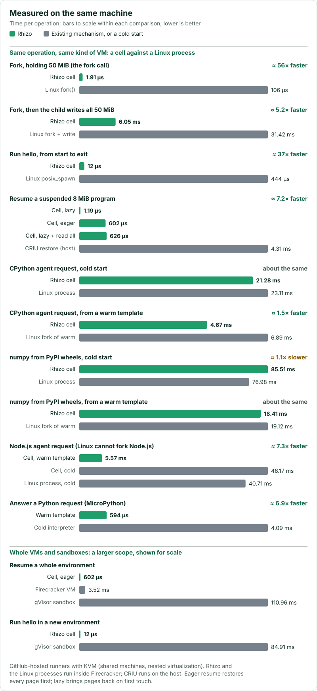
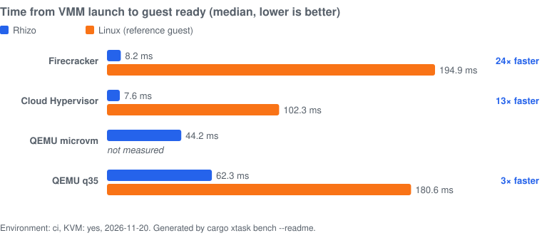
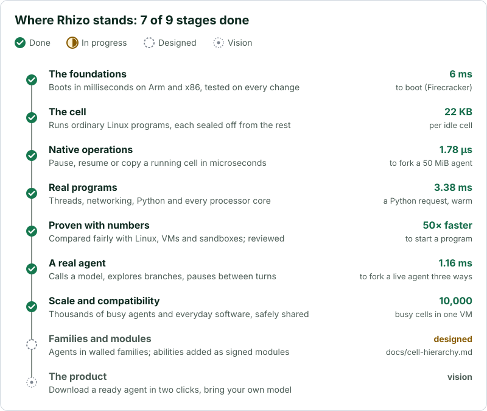

<p align="center">
  <picture>
    <source media="(prefers-color-scheme: dark)" srcset="docs/logo/rhizo-logo-dark.svg">
    
  </picture>
</p>

<p align="center"><b>An operating system kernel built for AI agents.</b></p>

Rhizo is an open-source (MIT) kernel, written in Rust, whose basic unit is not
the process or the container but the **agent cell**: an isolated environment
that can be created, suspended, resumed and forked as native kernel operations.

> **Status: pre-alpha proof of concept.** Nothing here is usable in production
> yet. See [where it stands](#status).

## The problem

An AI agent that runs code today sits on top of a tall stack. Every layer was
designed for something else, and what agents need most (fast suspend and
resume, cheap clones of the whole environment, strict isolation of untrusted
code) is bolted on from the outside.

<p align="center">
  <picture>
    <source media="(prefers-color-scheme: dark)" srcset="docs/img/stack-dark.svg">
    
  </picture>
</p>

Agent workloads look nothing like classic services:

| Classic service | AI agent |
|---|---|
| Long-lived, always on | Short bursts, mostly idle (waiting for a model or a human) |
| Trusted code | Untrusted, model-generated code |
| Tens per node | Thousands per node, most of them asleep |
| Scaling means more replicas | What matters is suspending and resuming quickly |
| Static permissions | Per-task permissions: tools, network, secrets |

Rhizo explores what happens when those needs are the design center of the
kernel itself. The name comes from the *rhizome*: an underground stem that
branches into independent shoots (fork), can regrow a whole plant from a
fragment (snapshot) and lies dormant until it sprouts again (suspend/resume).

## What a cell can do

A cell runs an unmodified static Linux program (Rust or C with glibc) through
a Linux-compatible system call layer. Its whole state (memory, registers,
files) belongs to the kernel, so the kernel can stop it, copy it and start it
again:

<p align="center">
  <picture>
    <source media="(prefers-color-scheme: dark)" srcset="docs/img/lifecycle-dark.svg">
    
  </picture>
</p>

- **Suspend / resume.** A snapshot is a versioned, self-contained image of the
  cell. Resume is lazy: pages come back on first touch.
- **Fork(n).** Children share the parent's pages, and even its page tables,
  until one of them writes.
- **Templates.** Freeze a cell after its warm-up, then start new cells from it
  instead of from the executable.

## Thesis

The proof of concept must demonstrate one measurable claim:

> A kernel whose unit is the agent cell can create, suspend, resume and fork
> cells running real Linux programs orders of magnitude faster than today's
> microVM- and userspace-kernel-based sandboxes.

The targets are hypotheses the proof of concept must validate. Where they stand:

<p align="center">
  <picture>
    <source media="(prefers-color-scheme: dark)" srcset="docs/img/scorecard-dark.svg">
    
  </picture>
</p>

<details>
<summary>Targets next to the figures other sandboxes publish</summary>

The comparison figures are what each project or its users have published, on
different hardware and with different measurement methods, so they are orders
of magnitude to aim at, not a like-for-like comparison. The like-for-like
numbers are [below](#measured).

| Metric | Rhizo target | Firecracker | Unikraft | Hyperlight |
|---|---|---|---|---|
| Boot: VMM launch → guest ready (KVM) | **≤ 10 ms** (kernel part ≤ 1 ms) | < 125 ms to a Linux guest accepting API calls[^fc] | < 1 ms guest boot, ~3 ms including the Firecracker VMM[^uk] | sub-millisecond partition creation, no guest OS (reported)[^hl] |
| Resume a suspended cell / VM | **< 100 µs** (in-kernel, no VMM) | 4–28 ms snapshot restore reported[^fcr] | — | ~0.9 ms snapshot restore (hyperlight-unikraft v0.16)[^hlu] |
| Fork a 50 MiB cell | **< 1 ms** (stretch: < 200 µs with lazy copy-on-write) | no native fork (snapshot + restore of a copy) | no native fork in the open-source core | no native fork |
| Idle cell overhead | **a few KiB** plus its own pages | a microVM per sandbox (MiBs) | a microVM per app | a micro-VM per sandbox |

</details>

[^fc]: Agache et al., *Firecracker: Lightweight Virtualization for Serverless Applications*, NSDI 2020.
[^uk]: [Unikraft performance documentation](https://unikraft.org/docs/concepts/performance).
[^hl]: [Firecracker vs Microsoft Hyperlight](https://www.pandastack.ai/blog/firecracker-vs-microsoft-hyperlight/) (qualitative, not an official measurement).
[^fcr]: [Benchmarking Firecracker boot and restore](https://numavm.com/blog/2026-03-10-1-second-boot/) and [Restoring uniqueness in microVM snapshots](https://arxiv.org/pdf/2102.12892).
[^hlu]: [hyperlight-unikraft v0.16.0 release notes](https://github.com/hyperlight-dev/hyperlight-unikraft/releases/tag/v0.16.0).

## Measured

`cargo xtask bench` measures Rhizo and the existing mechanisms in the same run,
on the same machine, with the same clock:

<p align="center">
  <picture>
    <source media="(prefers-color-scheme: dark)" srcset="docs/img/measured-dark.svg">
    
  </picture>
</p>

The charts and the tables below come from the same run (the date is under the
tables). Shared runners are noisy, so figures move between runs; publishable
numbers will come from a dedicated machine. How benchmarks, environments and baselines work:
[`bench/README.md`](bench/README.md).

<details>
<summary>Boot time and the full comparison table</summary>

<!-- bench:start -->
Time from launching the VMM to the guest being ready (median, lower is better).
Rhizo prints its ready line at the end of boot; the reference is Firecracker's
CI Linux guest kernel with a minimal `/init` that prints the same line, booted
on the same machine with the same timing method.

<picture><source media="(prefers-color-scheme: dark)" srcset="bench/boot-time-dark.svg"></picture>

| VMM | Rhizo median (ms) | Rhizo p90 (ms) | Linux median (ms) | Linux p90 (ms) | Runs |
|---|---:|---:|---:|---:|---:|
| Firecracker | 9.7 | 10.1 | 201.5 | 203.2 | 20 |
| Cloud Hypervisor | 9.0 | 15.2 | 111.9 | 118.2 | 20 |
| QEMU microvm | 45.9 | 46.5 | — | — | 20 |
| QEMU q35 | 65.4 | 66.8 | 188.5 | 189.6 | 20 |

### Cells against existing mechanisms

Same machine, same run. Rhizo runs inside Firecracker; the sandbox column is a Linux guest in Firecracker (boot to its first output, or a snapshot restored by a new Firecracker process until the VM runs: the way such sandboxes resume and clone); the last column is plain Linux processes on the host, which isolate far less.

| Operation | Rhizo cell | Firecracker microVM | Linux process |
|---|---:|---:|---:|
| Start a program and run it to its exit (`hello`) | 7.2 µs | 201.48 ms | 111.5 µs |
| Resume a suspended environment until it runs | 1.3 µs | 3.74 ms | — |
| Fork an environment holding 50 MiB | 1.5 µs | 3.74 ms | 1.78 ms |
| Serve a request from a warm template | 15.5 µs | 3.74 ms | — |

Environment: `ci`, KVM: yes, measured 2026-11-20. Regenerate with
`cargo xtask bench --readme`.
<!-- bench:end -->

</details>

## Status

<p align="center">
  <picture>
    <source media="(prefers-color-scheme: dark)" srcset="docs/img/roadmap-dark.svg">
    
  </picture>
</p>

Each milestone ships its speed work with a benchmark that proves it; the
details live in the archived changes under
[`openspec/changes/archive/`](openspec/changes/archive/).

Out of scope for the proof of concept: networking, multicore, real disks,
hardware other than virtio/QEMU, full CPython, SDKs.

## Try it

You need [rustup](https://rustup.rs) (the pinned toolchain installs itself)
and QEMU 8.2 or later; the C test cells also need gcc with a static glibc.
On Debian/Ubuntu:

```bash
sudo apt-get install qemu-system-arm qemu-system-x86 gcc libc6-dev
```

Boot the kernel, run the in-kernel tests and every cell (AArch64, the default):

```bash
cargo xtask test
```

The same on the second architecture:

```bash
cargo xtask --arch x86_64 test
```

Benchmarks (Firecracker and Cloud Hypervisor need KVM; `xtask` downloads
pinned releases on first use):

```bash
cargo xtask bench
```

```bash
cargo xtask --arch x86_64 bench
```

`cargo xtask check` is the fast loop (format, lints, host tests, crate rules)
and `cargo xtask ci` runs everything CI runs. AArch64 is the primary
architecture: 16-bit ASIDs and TLB invalidation broadcast in hardware suit
cells that switch and fork all the time. x86_64 stays because GitHub's x86_64
runners are where CI can measure with KVM; only the thin `arch/` layer exists
twice, and every spec is tested on both
([trade-offs](openspec/changes/archive/2026-11-19-switch-to-arm64/design.md)).

## Principles

- **Primitives in the kernel.** Snapshot, resume, fork and capabilities are
  native kernel operations, not features added on top.
- **Linux ABI, not Linux code.** Cells run unmodified Linux binaries through a
  Linux-compatible syscall layer. No GPL code is copied into this repository.
- **Deterministic by design.** All hardware access goes through narrow
  interfaces so the kernel core can run inside a deterministic simulator.
- **Performance is a test.** Benchmarks run in CI with thresholds; a regression
  fails the build.
- **Specs first.** Every behavior is specified before it is built
  (see [`openspec/`](openspec/)).
- **Open for real.** MIT licensed, no proprietary core, no "open core" bait.
- **Model-agnostic.** Contribute with any AI coding agent, or with none.

## Learn more

- [`openspec/specs/`](openspec/specs/): how the system behaves today, one spec
  per capability.
- [`bench/README.md`](bench/README.md): every metric, environment and baseline.
- [`AGENTS.md`](AGENTS.md): code map, rules and the feedback loop (for people
  and AI coding agents alike).
- [`CONTRIBUTING.md`](CONTRIBUTING.md): how to contribute, with or without AI
  tools.

## License

[MIT](LICENSE)
