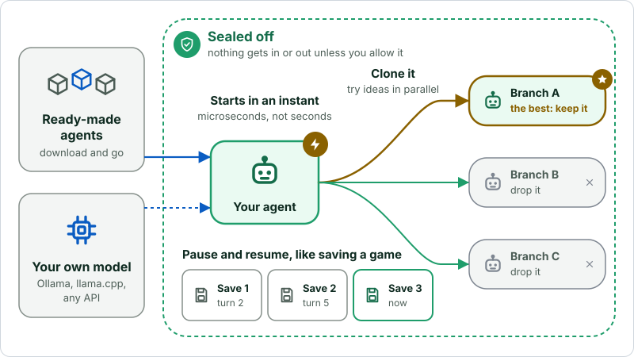
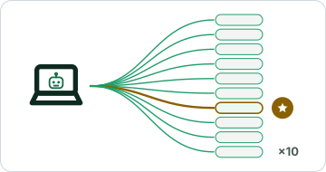
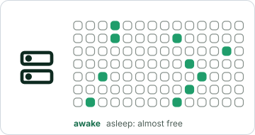
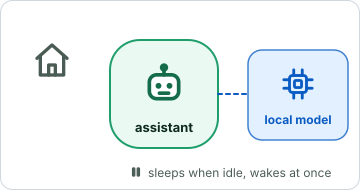
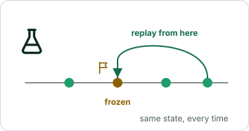
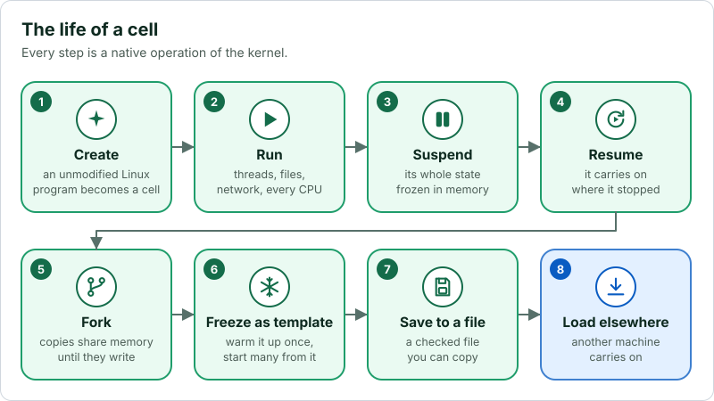
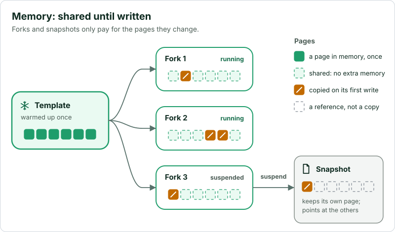
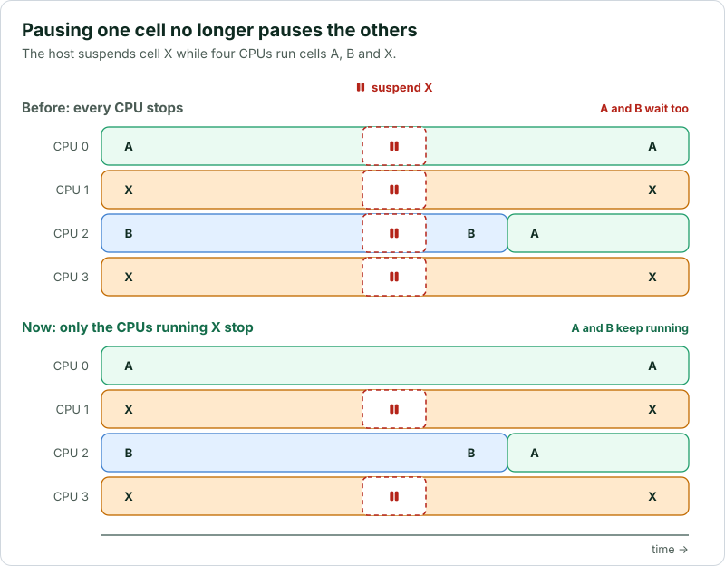
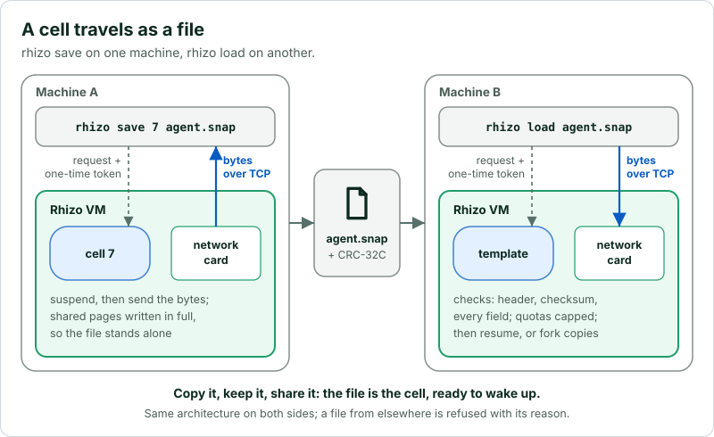

<p align="center">
  <picture>
    <source media="(prefers-color-scheme: dark)" srcset="docs/logo/rhizo-logo-dark.svg">
    
  </picture>
</p>

<h3 align="center">A home for AI agents: they start in an instant, pause and resume like a saved game, clone themselves to try ideas in parallel, and stay sealed off.</h3>

<p align="center">
  <a href="#try-it">Try it</a> ·
  <a href="#get-involved">Get involved</a> ·
  <a href="#the-numbers-that-matter">Numbers</a> ·
  <a href="#where-it-is-going">Roadmap</a> ·
  <a href="docs/overview.md">In depth</a>
</p>

<p align="center">
  <picture>
    <source media="(prefers-color-scheme: dark)" srcset="docs/img/hero-dark.svg">
    
  </picture>
</p>

AI agents don't just chat any more: they write code, run it, install
packages and open files. Each one needs a room of its own, a safe place to
work that it cannot break out of. Today that room is borrowed from tools built
for something else, so it is slow to open, heavy to keep and costly to copy.

**Rhizo is an operating system kernel built for agents from the ground up.**
Each agent lives in a **cell**. A cell opens in microseconds, sleeps for
almost nothing while the agent waits for its model, can be saved and picked
up later exactly where it was, and can be cloned in an instant so ten copies
try ten ideas at once and you keep the best one. One day you will download
ready-made agents in two clicks and run them with your own model, on your
laptop or by the thousand on a server. Rhizo is open source (MIT) and written
in Rust.

## Who it is for

<table>
<tr>
<td width="50%" valign="top">
<picture><source media="(prefers-color-scheme: dark)" srcset="docs/img/scene-dev-dark.svg"></picture>
<b>A developer tries ten strategies at once.</b> Clone the agent at the
moment it has to choose, let every copy try its own fix, keep the one that
passes the tests. The copies share memory until they change it.
</td>
<td width="50%" valign="top">
<picture><source media="(prefers-color-scheme: dark)" srcset="docs/img/scene-company-dark.svg"></picture>
<b>A company runs thousands of agents on little hardware.</b> Each customer's
agent is sealed in its own cell; sleeping ones cost a few kilobytes, so one
machine holds ten thousand busy cells.
</td>
</tr>
<tr>
<td width="50%" valign="top">
<picture><source media="(prefers-color-scheme: dark)" srcset="docs/img/scene-hobby-dark.svg"></picture>
<b>A hobbyist keeps a local assistant.</b> Your model runs on your own GPU;
the assistant lives next to it in a cell, sleeps when you are away, and wakes
in an instant with its files and history.
</td>
<td width="50%" valign="top">
<picture><source media="(prefers-color-scheme: dark)" srcset="docs/img/scene-research-dark.svg"></picture>
<b>A researcher freezes and replays an experiment.</b> Freeze an agent run at
any point, save it to a file, and replay it from there, on this machine or
another, as many times as needed.
</td>
</tr>
</table>

## Get involved

- **Try it in minutes**: `rhizo up`, then `rhizo chat` talks to an agent in a
  cell with your own model ([Try it](#try-it)).
- **Build it with us**: good first areas are listed [below](#contribute);
  every change starts as a small spec, so design reviews count as much as
  code.
- **Use it**: running agents for a product, a lab or a hobby? Open an issue
  with your workload; real workloads shape the roadmap.
- **Follow it**: star the repository and watch its releases.

> **Status: proof of concept, measured in CI.** Rhizo already runs CPython,
> Node.js and numpy agents in cells, on Arm and x86, with every figure below
> measured on each change. It is not ready for production, and its external
> security audit is still to come.

## What a cell does

A container shares one kernel among everyone; a microVM gives every agent a
whole operating system. A cell is a third way: one kernel built for agents,
with walls between cells and their life cycle built in.

<p align="center">
  <picture>
    <source media="(prefers-color-scheme: dark)" srcset="docs/img/compare-dark.svg">
    
  </picture>
</p>

<p align="center">
  <picture>
    <source media="(prefers-color-scheme: dark)" srcset="docs/img/story-dark.svg">
    
  </picture>
</p>

<p align="center">
  <picture>
    <source media="(prefers-color-scheme: dark)" srcset="docs/img/memory-dark.svg">
    
  </picture>
</p>

## The numbers that matter

Measured on every change by `cargo xtask bench`: Rhizo and what it is
compared with run in the same CI job, on the same machine, with the same
clock. The cards come from one run; the text gives the range over recent
runs.

<p align="center">
  <picture>
    <source media="(prefers-color-scheme: dark)" srcset="docs/img/highlights-dark.svg">
    
  </picture>
</p>

- **Node.js** forked from a warm template answers in about **4 to 6 ms**,
  against **34 to 46 ms** from a cold start; a Linux process cannot fork
  Node.js at all. With its JIT (under write-or-execute pages), a cold start is
  about **16 to 23% faster** than with `--jitless`.
- **numpy** runs **about as fast as in a Linux process** in the same kind of
  VM: a fork after `import numpy` takes 14 to 18 ms against 16 to 19 ms, and
  cold starts are within about 10% of each other.
- **On a laptop**, 50 agents of one template with 45 suspended take
  **6.6 MB** together, down from **60 MB** before snapshots referred to the
  pages they share.
- **A template saved to a file** and loaded into a fresh VM answers about
  **3 times sooner** than a cold agent (2.6 to 4.1 times over recent runs).
- **Host operations** on one cell stall the others about **6 to 7 times
  less**: 16 to 20 µs against 106 to 121 µs when every CPU stopped (one run
  saw only 3 times less on Cloud Hypervisor).
- **10,000 busy cells** on one vCPU: the 99th percentile of the wait to wake
  stays between **0.6 and 4 ms** depending on the VMM and the run, and is
  gated in CI like every other figure.
- For scale: a cell starts a program and runs it to its end in **7 to
  12 µs**, 37 to 73 times faster than a Linux process in the same VM, and
  forks while holding 50 MiB in **1 to 2 µs**.

<details>
<summary>Every measurement: charts, both architectures, boot time and the full tables</summary>

<p align="center">
  <picture>
    <source media="(prefers-color-scheme: dark)" srcset="docs/img/measured-dark.svg">
    
  </picture>
</p>

<p align="center">
  <picture>
    <source media="(prefers-color-scheme: dark)" srcset="docs/img/arches-dark.svg">
    
  </picture>
</p>

How the comparisons are made fair, and the thesis targets:
[`docs/overview.md`](docs/overview.md#thesis). Every metric, environment and
baseline: [`bench/README.md`](bench/README.md).

<!-- bench:start -->
Time from launching the VMM to the guest being ready (median, lower is better).
Rhizo prints its ready line at the end of boot; the reference is Firecracker's
CI Linux guest kernel with a minimal `/init` that prints the same line, booted
on the same machine with the same timing method.

<picture><source media="(prefers-color-scheme: dark)" srcset="bench/boot-time-dark.svg"></picture>

| VMM | Rhizo median (ms) | Rhizo p90 (ms) | Linux median (ms) | Linux p90 (ms) | Runs |
|---|---:|---:|---:|---:|---:|
| Firecracker | 8.2 | 9.2 | 191.1 | 194.4 | 20 |
| Cloud Hypervisor | 6.4 | 13.7 | 94.4 | 102.7 | 20 |
| QEMU microvm | 40.9 | 42.5 | — | — | 20 |
| QEMU q35 | 58.9 | 61.6 | 173.4 | 176.9 | 20 |

### A cell against a Linux process, in the same kind of VM

Same machine, same run. Rhizo runs inside Firecracker, and so does the Linux guest of the middle column (the same static programs, as its `/init`): both sides pay the same virtualization. The last column is the same program on the host, one layer of virtualization less. Lazy resume brings pages back on first touch; eager restores every page before the program runs.

| Operation | Rhizo cell | Linux process, same VM | Linux process, host |
|---|---:|---:|---:|
| The `fork` call, holding 50 MiB written | 1.2 µs | 89.5 µs | 695.0 µs |
| Fork, then the child writes all 50 MiB and exits | 3.80 ms | 21.62 ms | 19.48 ms |
| Start a program and run it to its exit (`hello`) | 7.1 µs | 517.0 µs | 96.0 µs |
| Resume a suspended 8 MiB program: lazy / eager (CRIU on the host) | 1.2 µs / 591.3 µs | — | 2.38 ms (CRIU) |

### Whole VMs and sandboxes, for scale

A microVM or a sandbox starts or restores a whole environment (a VM, or a sandbox process with its own kernel), a larger scope than a cell: these figures show the scale, not a like-for-like speed-up. The microVM is a Linux guest in Firecracker (boot to its first output, or a snapshot restored by a new Firecracker process); the gVisor sandbox runs on the host.

| Operation | Rhizo cell | Firecracker microVM | gVisor sandbox |
|---|---:|---:|---:|
| Start a program and run it to its exit (`hello`) | 7.1 µs | 191.07 ms | 72.63 ms |
| Resume a suspended environment until it runs (eager for the cell) | 591.3 µs | 3.70 ms | 94.10 ms |

### A real interpreter

CPython (static, 3.13.18) answering one agent tool call (`cells/python/agent_demo.py`: JSON, regular expressions, dates; the standard library it imports compiled in the cell's own files), in a cell and as a Linux process in the same Firecracker VM:

| Started | Rhizo cell | Linux process |
|---|---:|---:|
| Cold, from its executable (interpreter start, imports, warm-up) | 17.06 ms | 18.30 ms |
| Forked from an interpreter frozen (cell) or kept (process) after the warm-up | 3.82 ms (4.5× faster) | 5.50 ms |

MicroPython (static, v1.24.1) answering one request (`cells/python/rhizo_demo.py`, imported from the cell's own files), in a cell in Firecracker:

| Started | Time |
|---|---:|
| Cold, from its executable (interpreter start, imports, warm-up) | 3.43 ms |
| Forked from a template frozen after the warm-up | 468.3 µs (7.3× faster) |

numpy and its OpenBLAS, installed from their PyPI wheels into a dynamically linked CPython, computing on arrays (`cells/python/numpy_demo.py`: a linear solve, a ufunc, a matrix product), in a cell and as a Linux process in the same Firecracker VM:

| Started | Rhizo cell | Linux process |
|---|---:|---:|
| Cold (interpreter start, `import numpy`, compute) | 65.18 ms | 60.32 ms |
| Forked from an interpreter frozen (cell) or kept (process) after `import numpy` | 14.82 ms (4.4× faster) | 15.76 ms |

Node.js (the official build, dynamically linked, run unmodified with `--jitless`) answering one agent tool call (`cells/node/demo.js`), in a cell and as a Linux process in the same Firecracker VM (Node.js cannot fork itself, so the process has no warm row):

| Started | Rhizo cell | Linux process |
|---|---:|---:|
| Cold, from its executable (`ld.so`, V8 start-up, warm-up) | 35.00 ms | 31.10 ms |
| Forked from Node.js frozen after its warm-up | 4.48 ms (7.8× faster) | — |

### Both architectures, in instructions

Retired instructions per operation, counted under QEMU with `-icount` (the same on every run and every host): x86_64 on `microvm`, AArch64 on `virt`. GitHub's ARM64 runners have no KVM, so AArch64 has no timings from CI.

| Operation | x86_64 | AArch64 |
|---|---:|---:|
| Switch between two cells | 895 | 839 |
| Create the `hello` cell | 27,863 | 21,552 |
| Run `hello` from start to exit | 88,020 | 94,048 |
| Fork a cell holding 50 MiB | 6,759 | 7,472 |
| A static glibc program, cold | 35,245,617 | 36,518,944 |
| The same, forked from a warm template | 76,495 | 73,536 |

Environment: `ci`, KVM: yes, measured 2026-11-21. Regenerate with
`cargo xtask bench --readme`.
<!-- bench:end -->

</details>

## Try it

On a Linux machine with KVM, the shortest path to an agent in a cell talking
to your own model. The first `rhizo up` builds the kernel and CPython for the
cell, which takes a few minutes; after that it starts in a fraction of a
second.

```bash
git clone https://github.com/davidsalvat/rhizo && cd rhizo
sudo apt-get install qemu-system-x86 qemu-system-arm gcc libc6-dev zlib1g-dev
curl -LO https://www.python.org/ftp/python/3.13.18/Python-3.13.18.tar.xz
export RHIZO_CPYTHON_SRC=$PWD/Python-3.13.18.tar.xz
cargo build -p rhizo-cli && alias rhizo=$PWD/target/debug/rhizo

ollama serve & ollama pull qwen2.5:1.5b      # or llama-server, any model with tools
rhizo up
rhizo chat --llm http://127.0.0.1:11434 --model qwen2.5:1.5b
```

Inside the chat, `/fork 2` clones the conversation, `/switch N` moves between
branches and `/suspend` saves the branch for later (`rhizo chat N` picks it up
again). Everything else (the scripted agent, `rhizo run`, `fork`, `freeze`,
`save`, `load`, other VMMs, llama.cpp) is in [`docs/demo.md`](docs/demo.md).
Without a model, `cargo xtask test` boots the kernel and runs every test cell
([building and testing](docs/overview.md#building-and-testing)).

## Under the hood

One Rhizo kernel runs in one VM; cells are unmodified Linux programs above
it. The host drives the kernel with `rhizo` over the VM's serial line, and
cells reach the model through its network card.

<p align="center">
  <picture>
    <source media="(prefers-color-scheme: dark)" srcset="docs/img/architecture-dark.svg">
    
  </picture>
</p>

<p align="center">
  <picture>
    <source media="(prefers-color-scheme: dark)" srcset="docs/img/hostops-dark.svg">
    
  </picture>
</p>

<p align="center">
  <picture>
    <source media="(prefers-color-scheme: dark)" srcset="docs/img/snapshot-path-dark.svg">
    
  </picture>
</p>

The kernel is a set of library crates tested on the host, plus a thin
platform layer for each architecture; [`AGENTS.md`](AGENTS.md) has the code
map and [`openspec/specs/`](openspec/specs/) how each part behaves.

## Security

<p align="center">
  <picture>
    <source media="(prefers-color-scheme: dark)" srcset="docs/img/security-dark.svg">
    
  </picture>
</p>

Rhizo's isolation has been reviewed three times from the inside, and the
reviews and the work since have dealt with 26 findings (25 fixed, one worked
around), with fuzzers and hostile cells in CI that keep them fixed. Timing
side channels other than Meltdown and LazyFP are not covered yet. **No external audit has been done**: its scope, ranked
by risk and estimated at about 39 auditor-days, is ready in
[`docs/audit-scope.md`](docs/audit-scope.md). The threat model, every finding
and what is still open: [`docs/security.md`](docs/security.md).

## Where it is going

<p align="center">
  <picture>
    <source media="(prefers-color-scheme: dark)" srcset="docs/img/roadmap-dark.svg">
    
  </picture>
</p>

Designed and coming next ([`docs/cell-hierarchy.md`](docs/cell-hierarchy.md)):
agents that live in families, each family walled off from the others, and
abilities such as Python or numpy added as child cells from a signed
catalogue.

<p align="center">
  <picture>
    <source media="(prefers-color-scheme: dark)" srcset="docs/img/hierarchy-dark.svg">
    
  </picture>
</p>

<p align="center">
  <picture>
    <source media="(prefers-color-scheme: dark)" srcset="docs/img/modules-dark.svg">
    
  </picture>
</p>

- **Families of cells.** A tree of cells with budgets carved from the parent,
  so no fork bomb escapes them; capability handles whose rights only shrink;
  channels as the only way to talk; a private loopback per cell; egress
  policies per family (none, the model, an allowlist), checked on every
  socket; and an inventory of the 40 shared resources that could leak
  between families, each closed or measured.
- **Modular cells.** Python, numpy or Node.js added to an agent as child
  cells forked from warm templates, which share memory in a tree; a signed
  catalogue; a builder cell whose only way out is `rhizo proxy`, which serves
  only pinned, hash-checked files; and a small static chat agent that adds
  Python only when the model needs it.
- **The product.** Ready agents to download, an app on your own computer
  (macOS and Windows hosts too), your own model next to it
  ([`docs/vision.md`](docs/vision.md)).

## Contribute

Rhizo is built in the open with spec-driven development: every change starts
as a short proposal under [`openspec/changes/`](openspec/changes/), is
reviewed, then built with its tests and a benchmark. Contributions made with
any AI coding agent, or none, are welcome.

Good first areas:

- **Review the designs** of the cell hierarchy and of modules
  ([`add-cell-hierarchy`](openspec/changes/add-cell-hierarchy/),
  [`add-cell-modules`](openspec/changes/add-cell-modules/)) before they are
  built.
- **Run your own agent or program in a cell** and report what breaks: a
  missing Linux system call is a well-scoped change.
- **Measure on real hardware**, an ARM64 machine above all
  ([`bench/README.md`](bench/README.md#measuring-on-real-arm64-hardware-dedicated)).
- **Close a listed gap**: TLS for the CPython cell, a virtio-rng driver, a
  disk to save snapshots on VMs without a network card, coverage-guided
  fuzzing ([`docs/security.md`](docs/security.md#known-limitations-and-open-findings)).

Start with [`CONTRIBUTING.md`](CONTRIBUTING.md) (workflow, AI tools) and
[`AGENTS.md`](AGENTS.md) (rules, code map, the feedback loop:
`cargo xtask check` after every edit, `cargo xtask ci` before pushing).

## Learn more

- [`docs/overview.md`](docs/overview.md): the problem, the thesis and its
  targets, everything a cell does today, how the measurements stay fair.
- [`docs/demo.md`](docs/demo.md): agents in cells with your own model.
- [`docs/vision.md`](docs/vision.md): servers and personal computers, one
  engine.
- [`docs/cell-hierarchy.md`](docs/cell-hierarchy.md): families, capabilities,
  containment and modules (designed).
- [`docs/security.md`](docs/security.md) and
  [`docs/audit-scope.md`](docs/audit-scope.md): reviews, findings and the
  external audit's scope.
- [`openspec/specs/`](openspec/specs/): how the system behaves today, one
  spec per capability.
- [`bench/README.md`](bench/README.md): every metric, environment and
  baseline.

## License

[MIT](LICENSE)
