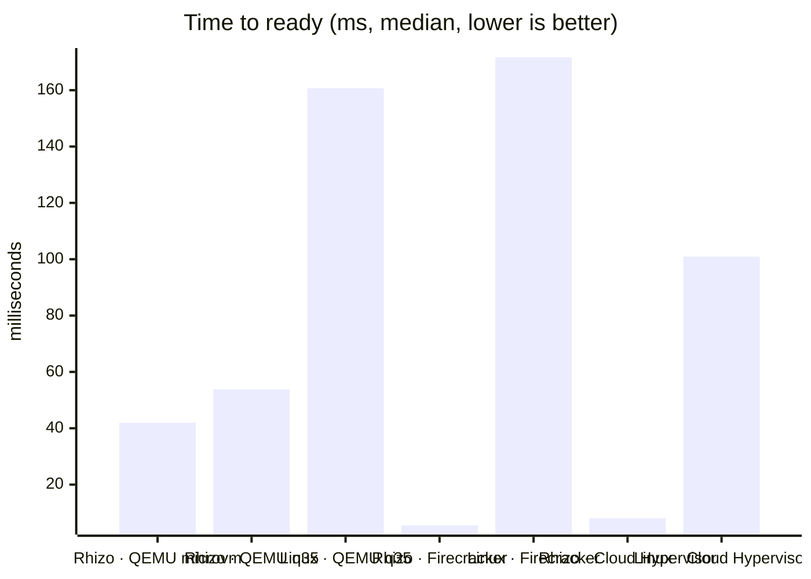

# Rhizo

**An operating system kernel built for AI agents.**

Rhizo is an open-source (MIT) kernel whose basic unit is not the process or the
container, but the **agent cell**: an isolated execution environment that can be
created, suspended, resumed and forked as native kernel operations.

> **Status: pre-alpha proof of concept.** Nothing here is usable yet. Follow the
> roadmap below to see where we are.

## Why

Today an AI agent that runs code sits on top of a tall stack:

```
orchestrator → host Linux → VMM or userspace kernel → (often) guest Linux → agent
```

Every layer was designed for something else, and the features agents need most
(fast suspend/resume, cheap cloning of the full environment, strict isolation of
untrusted code, fine-grained permissions) are bolted on from the outside.

Agent workloads look nothing like classic services:

| Classic service | AI agent |
|---|---|
| Long-lived, always on | Short bursts, mostly idle (waiting for a model or a human) |
| Trusted code | Untrusted, model-generated code |
| Tens per node | Thousands per node, most of them asleep |
| Scaling means more replicas | What matters is suspending and resuming quickly |
| Static permissions | Per-task permissions: tools, network, secrets |

Rhizo explores what happens when those needs are the design center of the
kernel itself.

The name comes from the *rhizome*: an underground stem that branches into
independent shoots (fork), can regrow a whole plant from a fragment (snapshot)
and lies dormant until it sprouts again (suspend/resume).

## Thesis

The proof of concept must demonstrate one measurable claim:

> A kernel whose unit is the agent cell can create, suspend, resume and fork
> cells running real Linux programs orders of magnitude faster than today's
> microVM- and userspace-kernel-based sandboxes.

## Performance targets

These are **hypotheses to validate**, not results. The comparison figures are
what each project or its users have published, on different hardware and with
different measurement methods, so they are orders of magnitude to aim at, not
a like-for-like comparison. `cargo xtask bench` produces the like-for-like
numbers (see [Benchmarks](#benchmarks)).

| Metric | Rhizo target | Firecracker | Unikraft | Hyperlight |
|---|---|---|---|---|
| Boot: VMM launch → guest ready (KVM) | **≤ 10 ms** (kernel part ≤ 1 ms) | < 125 ms to a Linux guest accepting API calls[^fc] | < 1 ms guest boot, ~3 ms including the Firecracker VMM[^uk] | sub-millisecond partition creation, no guest OS (reported)[^hl] |
| Resume a suspended cell / VM | **< 100 µs** (in-kernel, no VMM) | 4–28 ms snapshot restore reported[^fcr] | — | ~0.9 ms snapshot restore (hyperlight-unikraft v0.16)[^hlu] |
| Fork a 50 MiB cell | **< 1 ms** (stretch: < 200 µs with lazy copy-on-write) | no native fork (snapshot + restore of a copy) | no native fork in the open-source core | no native fork |
| Idle cell overhead | **a few KiB** plus its own pages | a microVM per sandbox (MiBs) | a microVM per app | a micro-VM per sandbox |

[^fc]: Agache et al., *Firecracker: Lightweight Virtualization for Serverless Applications*, NSDI 2020.
[^uk]: [Unikraft performance documentation](https://unikraft.org/docs/concepts/performance).
[^hl]: [Firecracker vs Microsoft Hyperlight](https://www.pandastack.ai/blog/firecracker-vs-microsoft-hyperlight/) (qualitative, not an official measurement).
[^fcr]: [Benchmarking Firecracker boot and restore](https://numavm.com/blog/2026-03-10-1-second-boot/) and [Restoring uniqueness in microVM snapshots](https://arxiv.org/pdf/2102.12892).
[^hlu]: [hyperlight-unikraft v0.16.0 release notes](https://github.com/hyperlight-dev/hyperlight-unikraft/releases/tag/v0.16.0).

## Principles

- **Primitives in the kernel.** Snapshot, resume, fork and capabilities are
  native kernel operations, not features added on top.
- **Linux ABI, not Linux code.** Cells run unmodified Linux binaries through a
  Linux-compatible syscall layer. No GPL code is copied into this repository.
- **Deterministic by design.** All hardware access goes through narrow
  interfaces so the kernel core can run inside a deterministic simulator.
- **Performance is a test.** Benchmarks run in CI with thresholds; a regression
  fails the build.
- **Specs first.** Every behavior is specified before it is built
  (see [`openspec/`](openspec/)).
- **Open for real.** MIT licensed, no proprietary core, no "open core" bait.
- **Model-agnostic.** Contribute with any AI coding agent, or with none.

## Roadmap (proof of concept)

| Milestone | Goal | Speed work (each with its benchmark) | Status |
|---|---|---|---|
| H0 | Boot in QEMU, serial console, in-kernel test harness, hardware boundary | — | Done |
| H1 | Physical memory, higher-half paging with W^X, kernel heap, CPU exceptions | Word-level frame bitmap, zero-cost init | Done |
| H1.5 | Fast boot and benchmarks: microvm, Firecracker, Cloud Hypervisor, fast console, release profile, CI gates | 1 GiB direct-map pages (`memory.kernel_pt_frames`, `boot.kernel_cycles`) | Done |
| H2 | First cell: user mode, ELF loader, basic Linux syscalls, static binaries | 2 MiB pages for cell memory where possible (`cell.spawn_us`, `cell.pt_frames`) | — |
| H3 | Multiple cells, scheduler, isolation tests | PCID: no TLB flush when switching cells (`cell.switch_ns`) | — |
| H4 | Suspend / resume with snapshot-equivalence tests | Lazy restore: snapshot pages mapped on first touch, an in-kernel analogue of Firecracker + `userfaultfd` (`cell.resume_us`, `cell.resume_touch_us`) | — |
| H5 | `fork(n)` with copy-on-write | Lazy copy-on-write including page tables (`cell.fork_us`, `cell.fork_pt_frames`); pre-warmed cell templates (`cell.spawn_from_template_us`) | — |
| H6 | Real workload (MicroPython) with differential tests against Linux | Template of a warm interpreter cell (`cell.spawn_from_template_us`) | — |
| H7 | Reproducible benchmarks against existing sandboxes | Dedicated KVM machine with tight thresholds | — |

Out of scope for the proof of concept: networking, multicore, real disks,
hardware other than virtio/QEMU, full CPython, SDKs.

## Benchmarks

<!-- bench:start -->
Time from launching the VMM to the guest being ready (median, lower is better).
Rhizo prints its ready line at the end of boot; the reference is Firecracker's
CI Linux guest kernel with a minimal `/init` that prints the same line, booted
on the same machine with the same timing method.



| Guest | VMM | Median (ms) | p90 (ms) | Runs |
|---|---|---:|---:|---:|
| Rhizo | QEMU microvm | 42.0 | 43.9 | 20 |
| Rhizo | QEMU q35 | 53.8 | 56.5 | 20 |
| Linux (reference) | QEMU q35 | 160.7 | 166.6 | 20 |
| Rhizo | Firecracker | 5.5 | 6.3 | 20 |
| Linux (reference) | Firecracker | 171.7 | 175.4 | 20 |
| Rhizo | Cloud Hypervisor | 8.1 | 11.0 | 20 |
| Linux (reference) | Cloud Hypervisor | 100.9 | 112.4 | 20 |

Environment: `ci`, KVM: yes, measured 2026-11-19. Regenerate with
`cargo xtask bench --readme`.
<!-- bench:end -->

How benchmarks, environments and baselines work: [`bench/README.md`](bench/README.md).

## Getting started

Prerequisites:

- [rustup](https://rustup.rs). The pinned toolchain (`rust-toolchain.toml`) is
  installed automatically on first use.
- QEMU for x86_64 (`qemu-system-x86_64`), version 8.2 or later is verified by
  CI; any version with PVH boot support (4.0+) should work. On Debian/Ubuntu:

```bash
sudo apt-get install qemu-system-x86
```

Commands:

| Command | What it does |
|---|---|
| `cargo xtask build` | Build the kernel image |
| `cargo xtask run` | Build and boot the kernel (QEMU `microvm` by default; `--vmm firecracker`, `--vmm cloud-hypervisor`, `--machine q35`) and report the time to ready |
| `cargo test` | Host tests only (no QEMU needed) |
| `cargo xtask test` | Host tests, boot check, in-kernel tests in QEMU and harness self-checks |
| `cargo xtask bench` | Release-build boot benchmarks on every available VMM, against a reference Linux guest |
| `cargo xtask ci` | Everything CI runs: formatting, clippy and all tests |

A successful boot looks like this:

```
Rhizo 0.1.0
memory: 126 MiB usable, 126 MiB free, 5 page-table frames
rhizo-ready cycles=13759354
boot time: 13759354 cycles
boot complete
[xtask] qemu-microvm: time to ready 51.18 ms (host), 13759354 kernel cycles
```

QEMU uses KVM automatically when `/dev/kvm` is available and falls back to
emulation otherwise (slower; timings are then not meaningful). Firecracker and
Cloud Hypervisor need KVM; `xtask` downloads pinned releases on first use.

## Repository layout

```
kernel/              Bootable kernel image (x86_64-unknown-none)
  src/arch/x86_64/   PVH boot trampoline and hardware drivers
crates/rhizo-hal/    Hardware interfaces (traits) and host test doubles
crates/rhizo-core/   Hardware-independent kernel logic, tested on the host
xtask/               Developer tool: build, run, test, ci
openspec/            Specifications and change proposals (spec-driven development)
AGENTS.md            Instructions for AI coding agents (open standard, any vendor)
CONTRIBUTING.md      How to contribute, with or without AI tools
```

## Contributing

See [CONTRIBUTING.md](CONTRIBUTING.md).

## License

[MIT](LICENSE)
