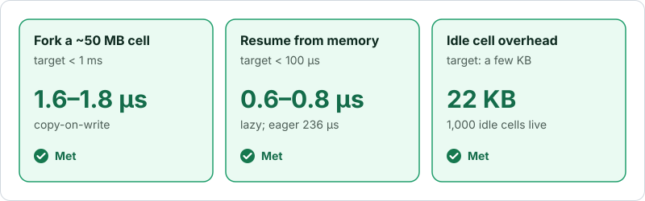

# Rhizo in depth

The [README](../README.md) shows what Rhizo is for and what it does, mostly in
pictures. This page keeps the longer explanations: the problem, the thesis
and its targets, everything a cell can do today, how the benchmarks compare
fairly, the principles and how to build and test the kernel. How the system
behaves is specified in [`openspec/specs/`](../openspec/specs/); where it goes
next is in [`vision.md`](vision.md) and [`cell-hierarchy.md`](cell-hierarchy.md).

## The problem

An AI agent that runs code today sits on top of a tall stack: an
orchestrator, host Linux, a VMM or a userspace kernel, and often a guest
Linux under the agent. Every layer was designed for something else, and what
agents need most (fast suspend and resume, cheap clones of the whole
environment, strict isolation of untrusted code) is bolted on from the
outside.

Agent workloads look nothing like classic services:

| Classic service | AI agent |
|---|---|
| Long-lived, always on | Short bursts, mostly idle (waiting for a model or a human) |
| Trusted code | Untrusted, model-generated code |
| Tens per node | Thousands per node, most of them asleep |
| Scaling means more replicas | What matters is suspending and resuming quickly |
| Static permissions | Per-task permissions: tools, network, secrets |

Rhizo explores what happens when those needs are the design center of the
kernel itself. Underneath, it rebuilds memory, scheduling and isolation
around the agent; on top, the goal is that none of it shows. The name comes
from the *rhizome*: an underground stem that branches into independent shoots
(fork), can regrow a whole plant from a fragment (snapshot) and lies dormant
until it sprouts again (suspend and resume).

## Two kinds of users, one engine

- **Platforms that run many agents on servers**, where density, cost per agent
  and isolation between customers matter.
- **People running agents on their own computer**, next to a local model,
  where an agent should cost almost nothing while idle.

On a personal computer the model runs next to Rhizo, not inside it: any
model and any runtime, at full GPU speed, with one shared copy of the
weights. Agents live in cells and talk to the model over a local socket;
each agent's state (program, history, files) lives in its cell, and that is
what Rhizo suspends, resumes and forks. The two-click app, the template
catalogue and the local socket are planned.

The full picture, and what the kernel still needs for it, is in
[`vision.md`](vision.md).

## What a cell can do today

A cell runs an unmodified Linux program (Rust or C with glibc, static or
dynamically linked, or an interpreter such as CPython or Node.js) through a
Linux-compatible system call layer. Its whole state (memory, registers,
files, sockets) belongs to the kernel, so the kernel can stop it, copy it and
start it again.

- **Suspend and resume.** A snapshot is a versioned image of the cell. Resume
  is lazy: pages come back on first touch. A snapshot refers to the pages the
  cell still shares with its template or its forks instead of copying them,
  so 50 agents of one template, 45 of them suspended, take 6.6 MB on x86_64
  (60 MB when snapshots copied every page).
- **Fork(n).** Children share the parent's pages, and even its page tables,
  until one of them writes.
- **Templates.** Freeze a cell after its warm-up, then start new cells from it
  instead of from the executable.
- **Snapshots and templates as files.** `rhizo save` writes a suspended cell
  or a template to a file on the host; `rhizo load` brings it into a fresh
  VM, on another boot or another machine of the same architecture. The bytes
  travel over TCP through the VM's network card, admitted with a one-time
  token, while requests stay on the control channel; a loaded file is checked
  (header, CRC-32C, every field), may not name a physical page, and its
  quotas are capped. A cell of a loaded template answers about 10 to 12
  times sooner than a cold agent.
- **Threads.** `pthread_create`, mutexes, condition variables and futexes;
  snapshots, forks and templates carry every thread.
- **Network.** Pipes, `poll`/`select`/`epoll`, Unix and TCP/UDP sockets
  between cells, and a virtio-net card (smoltcp) to reach the outside; the
  kernel keeps a suspended cell's connections open and hands them back on
  resume, and a fork's copies of them are reset.
- **Multi-core.** Cells run in parallel on up to 16 CPUs; CPUs that no other
  cell needs run more threads of a running cell at once (TLB shootdowns on
  x86_64); only system calls on sockets take turns. A host operation on one
  cell (suspend, resume, fork, freeze, kill) stops only the CPUs running that
  cell: the others keep running, and stall about 5 to 7 times less than when every
  CPU stopped.
- **CPython and packages from PyPI.** Unmodified CPython 3.13 runs as a cell,
  its standard library in the cell's own files; a template frozen after its
  imports answers each request without starting the interpreter again. A
  dynamically linked build loads packages installed from their PyPI wheels, C
  extensions included: numpy (with OpenBLAS) and requests. numpy's
  computation takes about as long as in a Linux process in the same kind of
  VM, cold or forked from a warm interpreter.
- **Node.js.** The official Node.js 24 build, dynamically linked and
  unmodified, runs as a cell with its JIT: V8 asks for memory both writable
  and executable, and the kernel gives it pages that are either, changed on
  faults, never both (change `node-jit`); with the JIT a cold start is about
  16 to 24% faster than with `--jitless`. A cell forked from Node.js frozen after
  its warm-up answers in about 4 to 7 ms, against about 30 to 46 ms from a
  cold start, in a cell or as a Linux process (which cannot fork Node.js).
- **Control plane.** `rhizo`, a command-line tool on the host, drives a
  running kernel over its vsock, authenticated with a secret the kernel
  draws at each boot and gives only on its serial line, or over the serial
  line where there is no socket device (every VMM answers); protocol
  version 4 returns a cell's first output with the reply that started it:
  `rhizo up`, `run`, `ps` (`--tree`), `fork`,
  `suspend`, `resume`, `freeze`, `save`, `load`, `attach`, `kill`, `down`;
  `rhizo chat` is an interactive conversation with an agent in a cell, whose
  tools run in the cell, and which can be forked, suspended and picked up
  later ([`demo.md`](demo.md)).
- **Quotas.** The host can cap each cell's memory, CPU time, descriptors and
  sockets; a cell past its quota is refused or ended, not its neighbours, and
  its quotas travel with its snapshots and forks.
- **The cell tree, being built** (change `add-cell-hierarchy`). Cells form
  a tree whose roots each start a domain, with identifiers per domain;
  the host places, re-parents, promotes, suspends and kills subtrees; CPUs
  are shared between domains by weight, with caps per subtree; the kernel
  sends the host an audit record for each tree change, cell creation and
  end, and refused request, which the host keeps in a hash-chained log
  (`rhizo audit tail`, `verify`); snapshots (format version 11) carry a
  cell's place in the tree; budgets carved from the parent, a private
  loopback network per cell and egress policies checked on every socket
  are in too. Channels and handles come next.
- **Isolation, reviewed.** Two adversarial reviews of the cell boundary and
  one of frames from the network, with hostile cells, property tests and a
  network fuzzer that keep the findings fixed. The kernel is unmapped while
  cell code runs on x86_64 CPUs open to Meltdown (KPTI; E0PD on AArch64),
  FP/SIMD state switches eagerly against LazyFP, and the kernel is
  kept out of cell memory (SMEP, SMAP, PAN). [`security.md`](security.md)
  lists the threat model, the findings and what is still open;
  [`audit-scope.md`](audit-scope.md) scopes an external audit, which has not
  been done yet.

Out of scope for the proof of concept: real disks, hardware other than
virtio/QEMU, SDKs.

## Thesis

The proof of concept must demonstrate one measurable claim:

> A kernel whose unit is the agent cell can create, suspend, resume and fork
> cells running real Linux programs orders of magnitude faster than today's
> microVM- and userspace-kernel-based sandboxes.

A cell is born inside a kernel that is already running, so it is closer to a
process than to a VM. The measurements therefore come in two tiers: a cell
against a Linux process doing the same operation in the same kind of VM (the
like-for-like gain, and the smaller one), and whole microVMs and sandboxes,
shown for scale. Resume is shown lazy (pages come back on first touch) and
eager (every page restored first).

The targets are hypotheses the proof of concept must validate. Where they
stand:

<p align="center">
  <picture>
    <source media="(prefers-color-scheme: dark)" srcset="img/scorecard-dark.svg">
    
  </picture>
</p>

The figures other projects publish, next to the targets. They were measured
on different hardware with different methods, so they are orders of
magnitude to aim at, not a like-for-like comparison; the like-for-like numbers
are in the [README](../README.md#the-numbers-that-matter).

| Metric | Rhizo target | Firecracker | Unikraft | Hyperlight |
|---|---|---|---|---|
| Boot: VMM launch → guest ready (KVM) | **≤ 10 ms** (kernel part ≤ 1 ms) | < 125 ms to a Linux guest accepting API calls[^fc] | < 1 ms guest boot, ~3 ms including the Firecracker VMM[^uk] | sub-millisecond partition creation, no guest OS (reported)[^hl] |
| Resume a suspended cell / VM | **< 100 µs** (in-kernel, no VMM) | 4–28 ms snapshot restore reported[^fcr] | — | ~0.9 ms snapshot restore (hyperlight-unikraft v0.16)[^hlu] |
| Fork a 50 MiB cell | **< 1 ms** (stretch: < 200 µs with lazy copy-on-write) | no native fork (snapshot + restore of a copy) | no native fork in the open-source core | no native fork |
| Idle cell overhead | **a few KiB** plus its own pages | a microVM per sandbox (MiBs) | a microVM per app | a micro-VM per sandbox |

[^fc]: Agache et al., *Firecracker: Lightweight Virtualization for Serverless Applications*, NSDI 2020.
[^uk]: [Unikraft performance documentation](https://unikraft.org/docs/concepts/performance).
[^hl]: [Firecracker vs Microsoft Hyperlight](https://www.pandastack.ai/blog/firecracker-vs-microsoft-hyperlight/) (qualitative, not an official measurement).
[^fcr]: [Benchmarking Firecracker boot and restore](https://numavm.com/blog/2026-03-10-1-second-boot/) and [Restoring uniqueness in microVM snapshots](https://arxiv.org/pdf/2102.12892).
[^hlu]: [hyperlight-unikraft v0.16.0 release notes](https://github.com/hyperlight-dev/hyperlight-unikraft/releases/tag/v0.16.0).

## How the measurements are made

`cargo xtask bench` measures Rhizo and the existing mechanisms in the same
run, on the same machine, with the same clock. Rhizo and the Linux processes
it is compared with both run inside Firecracker; CRIU and gVisor run on the
host. AArch64 has no KVM on GitHub's runners, so both architectures are also
compared in retired instructions under QEMU `-icount`, which are the same on
every run. Shared runners are noisy, so figures move between runs;
publishable numbers will come from a dedicated machine. Every metric,
environment and baseline is described in
[`bench/README.md`](../bench/README.md).

Two reference workloads run the kernel the way its two kinds of users will
([`bench/README.md`](../bench/README.md#reference-workloads)), on every VMM of
the same run:

- **Laptop**: 50 agents opened from one template in a 512 MiB VM, 45 of them
  suspended, take 6.6 MB together; opening one takes a few microseconds
  (about 50 to 80 µs on Firecracker), and while every agent waits the VM's
  CPUs wake about once a second.
- **Server**: 10,000 busy cells in a 1 GiB VM with one vCPU, about 35,000 to
  46,000 operations per second; the 99th percentile of the time a cell waits
  to be woken (about 0.4 to 4.7 ms, Firecracker the slowest) is gated like the
  other figures. Pushed until memory runs out (about 46,000 to 48,000 idle
  cells), the kernel refuses new cells cleanly and gets every byte back, its
  heap included.

## Principles

- **Primitives in the kernel.** Snapshot, resume, fork and capabilities are
  native kernel operations, not features added on top.
- **Linux ABI, not Linux code.** Cells run unmodified Linux binaries through a
  Linux-compatible syscall layer. No GPL code is copied into this repository.
- **Deterministic by design.** All hardware access goes through narrow
  interfaces so the kernel core can run inside a deterministic simulator.
- **Performance is a test.** Benchmarks run in CI with thresholds; a
  regression fails the build.
- **Specs first.** Every behavior is specified before it is built (see
  [`openspec/`](../openspec/)).
- **Open for real.** MIT licensed, no proprietary core, no "open core" bait.
- **Model-agnostic.** Contribute with any AI coding agent, or with none.

## Building and testing

You need [rustup](https://rustup.rs) (the pinned toolchain installs itself)
and QEMU 8.2 or later; the C test cells also need gcc with a static glibc.
On Debian/Ubuntu:

```bash
sudo apt-get install qemu-system-arm qemu-system-x86 gcc libc6-dev
```

Boot the kernel, run the in-kernel tests and every cell (AArch64, the
default), then the same on the second architecture:

```bash
cargo xtask test
cargo xtask --arch x86_64 test
```

Benchmarks (Firecracker and Cloud Hypervisor need KVM; `xtask` downloads
pinned releases on first use):

```bash
cargo xtask bench
cargo xtask --arch x86_64 bench
```

`cargo xtask check` is the fast loop (format, lints, host tests, crate rules)
and `cargo xtask ci` runs everything CI runs. [`AGENTS.md`](../AGENTS.md) has
the whole feedback loop and the code map.

AArch64 is the primary architecture: 16-bit ASIDs and TLB invalidation
broadcast in hardware suit cells that switch and fork all the time. x86_64
stays because GitHub's x86_64 runners are where CI can measure with KVM; only
the thin `arch/` layer exists twice, and every spec is tested on both
([trade-offs](../openspec/changes/archive/2026-11-19-switch-to-arm64/design.md)).
